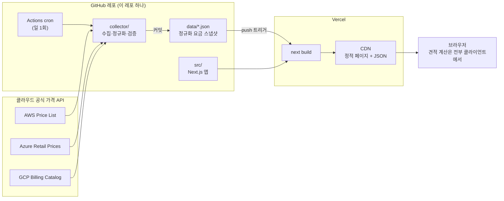
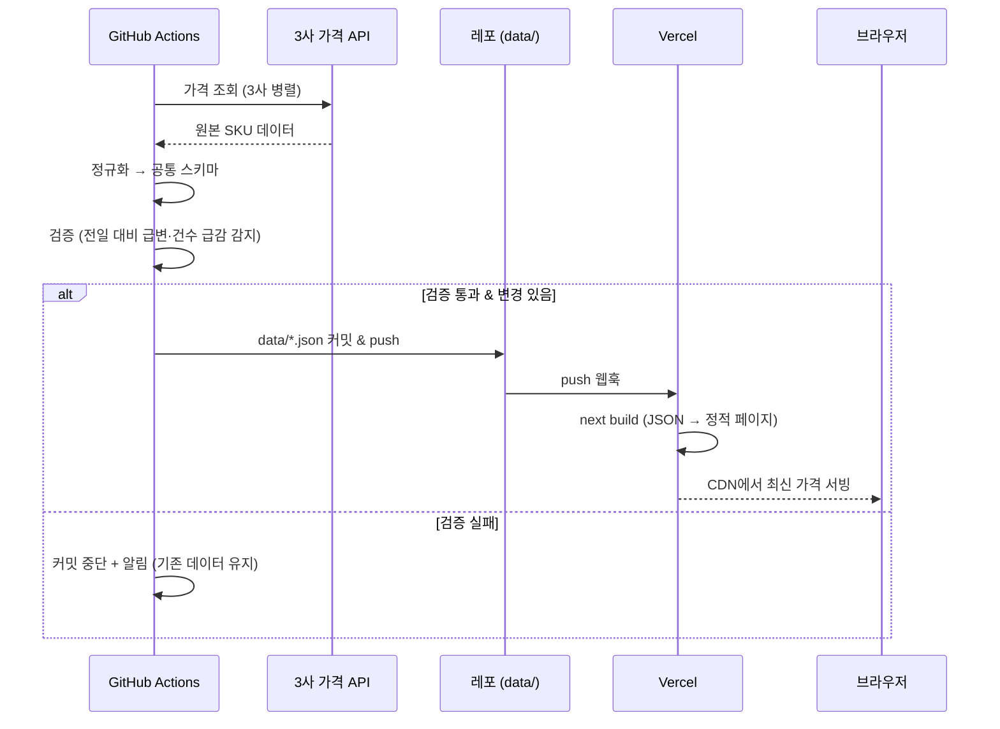
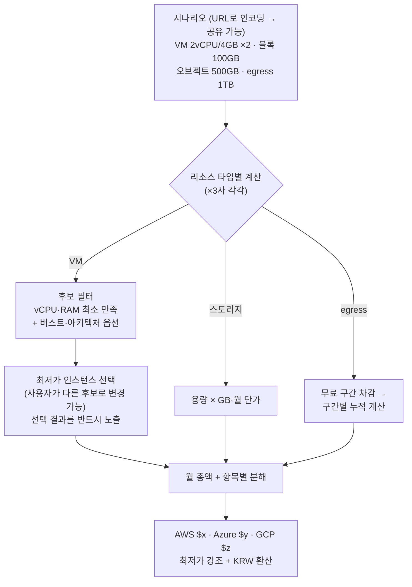

# 설계 문서

> 기획: [PLANNING.md](./PLANNING.md) · 스택: Next.js 풀스택 + JSON 스냅샷(DB 없음) + GitHub Actions cron + Vercel

## 1. 시스템 전체 구성



핵심: **서버·DB 없음.** 데이터 갱신 = 봇 커밋 = 재배포. 가격 이력은 git 히스토리가 대신한다.

## 2. 데이터 갱신 흐름 (일 1회)



- 검증은 갱신 조건이 아니라 **안전장치**다. 가격 ±30% 급변, SKU 건수 급감은 실제 가격 변동이 아니라 수집기 버그(API 응답 형식 변경, 페이지네이션 누락 등)일 확률이 높으므로, 오염된 데이터가 배포되기 전에 차단하고 어제 데이터를 유지한다.
- 알림 = 검증 실패 시 Actions 잡을 실패 처리 → **GitHub 기본 실패 알림(이메일)**. 성공 시엔 알림 없음(알림 피로 방지) — 정상 동작은 봇 커밋 히스토리와 사이트의 수집 시각 배지로 확인.

## 3. 레포 구조

```
cloud-cost/
├── .github/workflows/
│   └── collect.yml          # cron 워크플로우 (일 1회 + 수동 실행)
├── collector/               # 수집기 — Next.js와 독립 실행 (npm run collect)
│   ├── providers/
│   │   ├── aws.ts           # 원본 API → 공통 스키마
│   │   ├── azure.ts
│   │   ├── azure-vm-sizes.ts    # Azure 스펙 카탈로그 (API에 vCPU·RAM 없음)
│   │   ├── azure-db-sizes.ts    # Azure Database Flexible Server 사이즈 카탈로그 (같은 사정)
│   │   ├── azure-cache-sizes.ts # Azure Managed Redis SKU 용량 카탈로그 (같은 사정)
│   │   ├── gcp.ts           # ⚠ 난이도 최고 → 프로토타입 1순위
│   │   └── gcp-machine-types.ts # GCP 머신타입 카탈로그 (SKU는 코어·RAM 단가라 조합 필요)
│   ├── validate.ts          # 급변·누락 감지
│   └── main.ts
├── data/                    # 봇이 갱신하는 요금 스냅샷 (사람이 편집 금지)
│   ├── meta.json            # 수집 시각, USD/KRW 환율
│   └── {provider}/{region}/
│       ├── vm.json
│       ├── storage.json     # block-ssd + object-standard
│       ├── egress.json
│       ├── k8s.json         # 관리형 K8s 표준 클러스터 시간당 요금
│       ├── lb.json          # L7 로드밸런서 시간당 + 처리 GB당
│       ├── nat.json         # NAT 게이트웨이 시간당(게이트웨이당 또는 VM당) + 처리 GB당
│       ├── db.json          # 관리형 DB — 엔진별 인스턴스 목록(AWS·Azure) 또는 커스텀 단가(GCP) + 스토리지
│       ├── cache.json       # Redis 호환 캐시 — 노드 목록(AWS·Azure) 또는 GB 구간 단가(GCP)
│       ├── container.json   # 서버리스 컨테이너 — vCPU·GB 시간 단가(아키텍처별) + 약정
│       ├── cdn.json         # CDN — 전송·요청 구간 + 기본료·캐시 채움 + 정액 요금제(CloudFront)
│       └── logs.json        # 로그 수집 — 수집·보관 단가 + 포함 일수 + Commitment Tier(Azure)
├── messages/                # UI 문구 (en.json / ko.json) — next-intl
├── src/
│   ├── app/                 # 라우트 (§6)
│   ├── components/
│   ├── i18n/                # 로케일 라우팅 설정
│   ├── proxy.ts             # next-intl 미들웨어 (로케일 감지·리다이렉트)
│   └── lib/
│       ├── schema.ts        # 공통 타입 — collector와 웹이 공유 (§4)
│       ├── pricing.ts       # data/ 로더
│       └── estimator/       # 견적 엔진 — 순수 함수, UI 무관 (§5)
└── docs/
```

- **collector 실행 구조**: 워크플로우는 `npm run collect`(= `collector/main.ts`) 하나만 실행. main.ts가 providers 3개를 병렬 호출 → validate → `data/` 기록. 커밋은 워크플로우의 다음 스텝. 로컬에서도 같은 명령으로 실행 가능(그냥 Node 스크립트).
- **모듈 관계**: `data/*.json` → `pricing.ts`(경로·타입을 아는 유일한 로더) → `estimator/`(순수 함수 계산) → `components/`(표시).

### Next 앱 내부 (src/)

```
src/
├── app/                          # 파일 기반 라우팅 (폴더 = URL)
│   ├── [locale]/                 # 로케일 세그먼트 — en은 프리픽스 없음, ko는 /ko
│   │   ├── layout.tsx            # 공통 셸 (헤더/푸터, 메타데이터, 언어 스위처, 피드백)
│   │   ├── page.tsx              # `/` 시나리오 빌더
│   │   ├── instances/page.tsx    # `/instances` 비교표
│   │   └── methodology/          # `/methodology` 데이터 안내 (content.tsx = 로케일별 본문 JSX)
│   └── api/feedback/route.ts     # POST — 피드백 → GitHub 이슈 생성
├── components/
│   ├── scenario/
│   │   ├── ScenarioBuilder.tsx   # 'use client' — 시나리오 상태 + URL 동기화
│   │   ├── ResourceCard.tsx      # 리소스 카드 (공통 틀 + 타입별 입력 필드)
│   │   ├── NumberField.tsx
│   │   └── EstimateResult.tsx    # 3사 견적 카드 + 비용 분해 + 인스턴스 드롭다운
│   ├── instances/
│   │   └── InstanceTable.tsx     # 필터 가능한 단품 비교표
│   ├── DataFreshness.tsx         # 수집 시각 배지
│   ├── FeedbackWidget.tsx
│   └── LocaleSwitcher.tsx
└── lib/
    ├── schema.ts
    ├── pricing.ts
    ├── scenario-url.ts           # 시나리오·매칭 옵션·커스텀 선택 ↔ URL 코덱
    ├── display.ts                # 통화(USD/KRW)·기간(시간/일/주/월) 표시 변환
    ├── seo.ts                    # canonical·hreflang
    ├── templates.ts              # 시나리오 템플릿 (프리셋 구성도 = resources 배열)
    └── estimator/
        ├── index.ts              # 리소스 레지스트리(RESOURCES) + estimate() 진입점
        ├── types.ts              # 공통 타입 (Scenario·Resource·EstimateLine·ResourceDef)
        ├── vm.ts                 # VM — 매칭(최저가·후보·실패 이유) + URL 토큰
        ├── storage.ts            # 블록·오브젝트 스토리지
        ├── egress.ts             # 아웃바운드 트래픽 — 구간 요금
        ├── k8s.ts                # 관리형 K8s — 컨트롤 플레인 + 워커 노드(VM 매칭 재사용)
        ├── lb.ts                 # L7 로드밸런서 — 시간당 × 대수 + GB당 × 처리량
        ├── nat.ts                # NAT 게이트웨이 — GCP는 시나리오 VM 수 기준(32대/게이트웨이 상한)
        ├── db.ts                 # 관리형 DB — AWS·Azure 사이즈 목록 매칭 / GCP 커스텀 사이즈 계산 + 스토리지
        ├── cache.ts              # Redis 호환 캐시 — AWS·Azure 노드 매칭 / GCP GB 구간 단가
        ├── container.ts          # 서버리스 컨테이너 — 플랫폼별 허용 vCPU·메모리 조합으로 올림
        ├── cdn.ts                # CDN — 종량제 구간 계산 vs CloudFront 정액 요금제 중 싼 쪽
        ├── logs.ts               # 로그 수집 — 수집 + 포함 기간 넘는 보관, Azure Commitment Tier 비교
        └── estimator.test.ts     # 견적 정확성 = 테스트로 보장
```

- 기본은 서버 컴포넌트(빌드 시 HTML로 구움) — `/instances`, `/methodology`는 순수 SSG로 SEO 대응.
- `ScenarioBuilder`만 `'use client'`: 요금표 JSON을 번들에 포함해 내려보내고(v1 규모 수백 KB), 입력 변경 시 브라우저에서 estimator 즉시 재실행 → 서버 왕복 없는 실시간 견적. 매일 재빌드되므로 번들 속 요금표도 항상 최신.

## 4. 데이터 스키마 (`src/lib/schema.ts`)

> **SKU**(Stock Keeping Unit): 과금되는 상품 단위 하나. "서울 리전의 t3.medium, Linux, 온디맨드"가 SKU 1개다. 3사 가격 API가 모두 쓰는 표준 용어.

```ts
type Provider = 'aws' | 'azure' | 'gcp';
type Region = 'seoul' | 'us-east';          // 정규화 리전 키 (아래 매핑표)
type Arch = 'x86' | 'arm';                  // arm = Graviton(AWS)·Ampere(Azure/GCP)

/** VM — 가격은 USD, Linux 온디맨드, 시간당 */
interface VmSku {
  provider: Provider;
  region: Region;
  sku: string;              // "t3.medium" | "e2-medium" | "Standard_B2s"
  vcpu: number;
  ramGb: number;
  burstable: boolean;       // 매칭 시 포함/제외 옵션
  arch: Arch;               // 매칭 필터 + 표시 배지 (arch 도입 전 스냅샷은 로더가 x86로 백필)
  generation: string;       // 패밀리 키 (t3·m5·dsv5·e2·n2 …)
  pricePerHour: number;
  commit?: CommitPrices<number>; // 약정 시간당 (아래)
}

/** 약정가 — 기간별, 인스턴스 고정형·선결제 없음 기준 시간당 실효가. 키가 없으면 그 기간 약정 상품 없음 */
type Term = '1y' | '3y';
type CommitPrices<T> = Partial<Record<Term, T>>;

/** 스토리지 — GB·월 단가 */
interface StorageSku {
  provider: Provider;
  region: Region;
  kind: 'block-ssd'          // VM에 붙는 디스크 (EBS/Managed Disk/PD) — v1은 범용 SSD 고정
      | 'object-standard';   // S3류 오브젝트 스토리지 (S3/Blob/GCS) — v1은 표준 티어만
  pricePerGbMonth: number;
}

/** egress = 클라우드 밖(인터넷)으로 나가는 데이터 전송. 들어오는 건(ingress) 3사 모두 무료, 나가는 것만 GB당 과금 */
interface EgressTier {
  provider: Provider;
  region: Region;
  freeGb: number;           // 월 무료 구간
  tiers: { upToGb: number | null; pricePerGb: number }[];  // null = 무제한
}

/** 관리형 K8s 컨트롤 플레인 — 표준(SLA 포함) 티어. EKS 기본 / AKS Standard / GKE Regional */
interface K8sClusterPrice {
  provider: Provider;
  region: Region;
  clusterPerHour: number;
}

/** L7 로드밸런서 — LCU·CU(공식 정의상 시간당 1GB)를 GB당 단가로 환산 */
interface LbPrice {
  provider: Provider;
  region: Region;
  perHour: number;
  perGb: number;
}

/** NAT 게이트웨이 — GCP Cloud NAT만 시간당 요금이 VM 1대당 (maxVms대 상한) */
interface NatPrice {
  provider: Provider;
  region: Region;
  hourly: { per: 'gateway'; usd: number } | { per: 'vm'; usd: number; maxVms: number };
  perGb: number;
}

/** 관리형 DB — 엔진별. instances(AWS RDS 클래스·Azure SKU) 또는 custom(GCP vCPU·RAM 단가) */
type DbEngine = 'mysql' | 'postgres';
interface DbInstance { sku: string; vcpu: number; ramGb: number; burstable: boolean; perHour: number; haPerHour: number | null;
  commit?: CommitPrices<{ perHour: number; haPerHour: number | null }> }
interface DbRateSet { vcpuPerHour: number; ramGbPerHour: number; haVcpuPerHour: number; haRamGbPerHour: number }
interface DbEnginePricing {
  instances: DbInstance[];
  custom: (DbRateSet & { commit?: CommitPrices<DbRateSet> }) | null;
  storageGbMonth: number;
  haStorageGbMonth: number;
}
interface DbPrice { provider: Provider; region: Region; engines: Record<DbEngine, DbEnginePricing | null> }

/** Redis 호환 캐시 — nodes(AWS Valkey 노드·Azure Managed Redis SKU) 또는 gbTiers(GCP, 용량이 속한 구간 단가 × 용량 전체) */
interface CacheNode { sku: string; memoryGb: number; burstable: boolean; perHour: number; haPerHour: number;
  commit?: CommitPrices<{ perHour: number; haPerHour: number }> }
interface CacheGbTier { upToGb: number | null; perGbHour: number; haPerGbHour: number;
  commit?: CommitPrices<{ perGbHour: number; haPerGbHour: number }> } // GCP M1(5GB 미만)은 약정 없음
interface CachePrice { provider: Provider; region: Region; engine: string; nodes: CacheNode[]; gbTiers: CacheGbTier[] | null }

/** 서버리스 컨테이너 — Fargate / Container Apps / Cloud Run 상시 실행 vCPU·GB 시간 단가 (ARM은 Fargate만). 허용 사이즈 규칙은 estimator/container.ts */
interface ContainerRate { vcpuPerHour: number; gbPerHour: number }
interface ContainerPrice { provider: Provider; region: Region; rates: Partial<Record<Arch, ContainerRate & { commit?: CommitPrices<ContainerRate> }>> }

/** CDN — 시청자 방향 GB 구간·요청(1만 건) 구간·월 기본료·캐시 채움 GB당·정액 요금제(CloudFront) */
interface PriceTier { upTo: number | null; price: number }
interface CdnPlan { name: string; monthlyUsd: number; maxGb: number; maxRequests: number }
interface CdnPrice { provider: Provider; region: Region; gbTiers: PriceTier[]; requestTiers: PriceTier[]; monthlyBase: number; fillPerGb: number; plans: CdnPlan[] }

/** 로그 수집 — 수집 GB당 + 보관 GB·월(포함 일수 이후, AWS는 압축 배율) + Azure Commitment Tier */
interface LogPrice { provider: Provider; region: Region; ingestPerGb: number; storagePerGbMonth: number; includedDays: number; storedRatio: number; commitmentTiers: { gbPerDay: number; perDay: number }[] }

/** data/meta.json */
interface Meta {
  collectedAt: string;      // ISO 8601
  usdKrw: { rate: number; at: string } | null;  // 환율 조회 실패 시 null
}
```

**리전 매핑표**

| 정규화 키 | AWS | Azure | GCP |
|---|---|---|---|
| `seoul` | ap-northeast-2 | koreacentral | asia-northeast3 |
| `us-east` | us-east-1 | eastus | us-east1 |

## 5. 견적 엔진 (`src/lib/estimator/`)



- 순수 함수로 작성 (`estimate(scenario, priceData) → Estimate[]`) — 테스트가 곧 검증 수단
- **시나리오 = 리소스 카드 목록** (`resources: Resource[]`, 카드 순서 그대로). 리소스 타입마다 `ResourceDef`(기본값 · URL 토큰 인코딩/디코딩 · 견적 줄 계산)를 구현한 모듈 하나가 있고, `index.ts`의 `RESOURCES` 레지스트리에 등록한다. `estimate()`는 카드를 돌며 각 정의에 위임하고 합산만 한다
  - 새 리소스 추가 = 모듈 1개 + 레지스트리 1줄 + `Resource` 유니온 1줄 + `ResourceCard` 입력 필드 + 문구
  - 견적 줄마다 `resourceIndex`(만든 카드)가 붙는다 — 카드 하나가 여러 줄을 낼 수 있음 (예: K8s = 컨트롤 플레인 + 노드)
  - `singleton` 타입은 시나리오에 하나만: 트래픽은 구간 요금이 전체 전송량 기준이라 카드를 나누면 무료 구간이 중복 적용됨
  - 리소스 모듈은 `types.ts`만 import (`index.ts`를 import하면 순환 참조)
  - 다른 카드를 참조해야 하는 리소스는 `estimate` 컨텍스트의 `scenario`를 쓴다 (NAT: GCP 과금 VM 수 = VM 카드 대수 + K8s 노드 수)
- 월 환산: 시간당 가격 × **730시간** 고정
- 매칭 옵션: 버스트 포함(기본 포함), 아키텍처 `both`(기본) / `x86` / `arm`, 약정 기간 `term`(생략 = 정가 / `1y` / `3y`). 현세대 한정은 수집 단계에서 걸러짐(엔진에 세대 필터 없음)
- 약정 기간이 있으면 VM·K8s 노드·DB·캐시 후보의 가격을 약정가로 바꿔(`priceAt`) 그 기준으로 최저가를 찾는다. 약정가 없는 후보는 정가로 남고 매칭 결과에 `committed: false` — 화면은 "약정가 없음" 배지. 매칭 결과의 `perHour`가 선택한 기준 가격(VM은 `pricePerHour`에 정가 보존)
- 커스텀 선택: 드롭다운 후보 = 조건 충족 SKU 중 사이즈(vCPU·RAM)별 최저가 1개. 고른 SKU가 조건에서 벗어나면 최저가로 self-heal. 선택은 카드 인덱스 기준으로 저장
- 매칭 실패 시 이유(`noMatch`)를 함께 반환: `arch`(버스트·아키텍처 조건에 맞는 SKU가 리전에 없음) / `size`(조건 내 최대 vCPU·RAM 안내) — "견적 불가"가 버그로 보이지 않게
- 시나리오 상태는 URL 쿼리에 인코딩 → 저장 기능 없이 공유 가능. 예: `/?r=seoul&res=vm:2c4g:2,blk:100,obj:500,eg:1024&arch=x86&burst=0&term=1y&pick=aws:0:t3.large` — URL 자체가 시나리오 데이터라서 열면 같은 화면이 재구성됨. `res`는 카드 순서대로 `토큰:본문`(본문 형식은 리소스 모듈이 정함), `pick`의 숫자는 카드 인덱스 (`arch`·`burst`·`term`·`pick`은 기본값이면 생략). v0.3 이전 형식(`vm=`·`blk=` …)은 지원 안 함 — 열면 기본 시나리오
- 통화·기간 전환은 엔진 밖 표시 계층(`display.ts`)에서 월 USD에 곱셈만 — 엔진 출력은 항상 월 USD

## 6. 라우트

| 경로 | 렌더링 | 내용 |
|---|---|---|
| `/` | SSG + 클라이언트 계산 | 시나리오 빌더 + 실시간 3사 견적 (핵심 화면) |
| `/instances` | SSG | 인스턴스 단품 비교표 — SEO 랜딩 |
| `/methodology` | SSG | 데이터 출처·수집 시각·계산 방식·한계 고지 |
| `/api/feedback` | 서버리스 함수 (POST) | 피드백 폼 → GitHub 이슈 생성 (허니팟 스팸 방어). Vercel env `FEEDBACK_GITHUB_TOKEN` 필요 |
| `/sitemap.xml` · `/robots.txt` | 정적 생성 | 검색 엔진용 페이지 목록(페이지 × 언어 + hreflang, lastmod = 가격 수집 시각) · 크롤링 규칙(/api 제외). 기준 도메인은 www (`seo.ts` SITE_URL) |

- 페이지는 모두 영어가 기본(프리픽스 없음), 한국어는 `/ko` 프리픽스 (`/ko/instances` 등). hreflang·canonical은 `seo.ts`

## 7. 설계 결정 요약

| 결정 | 선택 | 이유 |
|---|---|---|
| 견적 계산 위치 | 클라이언트 | 요금표 몇 MB → 브라우저에서 즉시 재계산, 서버 불필요 |
| 데이터 저장 | git 커밋되는 JSON | DB 오버엔지니어링 회피 + 이력 공짜 |
| 갱신 전략 | 커밋 → 재빌드 (ISR 불사용) | 일 1회 갱신이면 충분, 파이프라인 단순 |
| 수집기 언어 | TypeScript (웹과 동일) | `schema.ts` 타입 공유로 수집↔웹 스키마 불일치 원천 차단 |
| 시나리오 공유 | URL 인코딩 | 계정/DB 없이 공유 가능, v3에서 단축 URL 추가 여지 |
| VM 범위 | x86 + ARM, 기본은 둘 다 통틀어 최저가 (2026-07-20, 이전 결정 "x86만" 대체) | ARM이 대개 더 싸서 빼면 실제 최저가를 놓침. 앱 호환성 문제는 아키텍처 토글(둘 다/x86/ARM) + ARM 배지·안내로 사용자에게 맡김 |
| 버스트 인스턴스 | 기본 포함, 체크박스로 제외 (끄면 URL에 `burst=0`) | 기획 §10-1 미결정 사항을 구현으로 확정 |
| 국제화 | 영어 기본(`/`) + 한국어(`/ko`), next-intl `as-needed` | 언어 스위처는 일반 `<a>` — `Link` 프리페치가 `/`→`/ko` 리다이렉트를 캐시해 전환이 깨지는 문제 회피 |
| 피드백 창구 | 폼 → `/api/feedback` → GitHub 이슈 | DB 없는 구조 유지 |
| 블록 스토리지 지표 | 범용 SSD: gp3 / Balanced PD / **Premium SSD v2** | Azure 관리 디스크는 고정 크기 과금이라 per-GB 모델과 불일치 → 유일한 per-GB 디스크인 SSD v2 사용 |
| egress 지표 | 3사 모두 **인터넷 라우팅** 기준 | GCP Premium 티어는 목적지별 SKU라 단일 가격이 없음 → GCP Standard 티어 / Azure Routing Preference: Internet / AWS 기본으로 통일 |
| K8s 컨트롤 플레인 지표 (2026-10-11) | **표준(SLA 포함) 티어**: EKS 기본 / AKS Standard / GKE Regional (수집 시점 3사 모두 $0.10/h) | 운영 서비스 기준 + 기존 "프리티어 미반영" 원칙. AKS Free 티어·GKE 월 크레딧은 고지만. 연장 지원·Provisioned·AKS Automatic·GKE Autopilot(파드 단위 과금)은 제외 |
| 로드밸런서 지표 (2026-10-11) | **L7(HTTP)**: AWS ALB / Azure Application Gateway Standard v2 / GCP 리전 외부 애플리케이션 LB. 입력 = 대수 + 월 처리 GB | 3사 모두 "시간당 고정 + 처리량" 구조로 정리됨. LCU·CU는 공식 정의상 시간당 1GB라 GB당 단가로 환산 — 연결 수·규칙 평가 차원은 미반영(연결이 아주 많으면 과소 추정). GCP는 인/아웃 처리량을 각각 과금하므로 총 처리 GB × 단가. L4(NLB 등)는 범위 밖 |
| NAT 지표 (2026-10-11) | 게이트웨이 시간당 + 처리 GB당. GCP Cloud NAT는 VM당 시간 요금이라 **시나리오의 VM 대수 + K8s 노드 수**를 과금 VM으로 자동 산정(게이트웨이당 32대 상한, 문서값) | 입력 중복 없이 구성도대로 계산. NAT 처리비는 인터넷 egress 요금과 별개로 더해짐(실제 청구와 동일). 공인 IP 시간 요금(3사 $0.004~0.005/h)은 LB·NAT·VM 공통이라 제외 |
| 관리형 DB 지표 (2026-10-11) | AWS RDS / Azure Database Flexible Server / GCP Cloud SQL Enterprise, MySQL·PostgreSQL. 스펙 만족 최저가(AWS·Azure 사이즈 목록, GCP 커스텀 사이즈 계산). 이중화 = 대기 포함 단가(≈2배) | Aurora(I/O 과금 등 구조 상이)·Enterprise Plus(상위 등급)·Single Server(단종)·공유 코어(SLA 없음) 제외. 엔진별 가격이 AWS·Azure에서 달라 엔진 단위 저장. 아키텍처 토글 미적용(관리형이라 ARM 호환성 무관), 버스트 옵션은 적용. Azure 버스트는 HA 미지원(문서) → HA 시 후보 제외. GCP 사이즈 규칙(vCPU 1·짝수 ≤96, RAM 0.9~6.5GB/vCPU·256MB 단위·최소 3.75GB)은 문서값 상수. 백업·추가 IOPS 제외 |
| 캐시 지표 (2026-10-12) | Redis 호환: **AWS ElastiCache Valkey** / **Azure Managed Redis** / GCP Memorystore for Redis(인스턴스형). 입력 = 메모리 GB · 이중화 · 개수 | AWS는 Redis OSS보다 20% 싼 기본 엔진 Valkey(Redis 호환). Azure Cache for Redis(C0~C6)는 2028-09-30 퇴역 공지 → 대체재인 Managed Redis. Azure 이중화 = API 미터(노드 1개) × 2는 가격 페이지의 1노드/2노드 열 구조로 **추론**(숫자 직접 대조 불가) — methodology 고지. GCP는 용량이 속한 구간 단가가 용량 전체에 적용(누적 아님), 1~300GB. Memcached·노드형 Memorystore(클러스터 전제) 제외. Azure B0 용량은 문서가 엇갈려 0.5GB, 235GB까지만 수록 |
| K8s 노드 버스트 (2026-10-17) | 워커 노드는 버스트 옵션과 무관하게 **항상 버스트 제외** | 파드를 몰아넣어 꾸준히 쓰는 노드엔 CPU 크레딧 방식이 안 맞음. GCP는 4c16g급 버스트가 없어 AWS·Azure만 버스트가 뽑히던 불공정도 해소. 작은 개발 클러스터용 허용 요구가 오면 카드별 옵션으로 확장 |
| 약정 할인 (2026-10-17) | 요금 기준 토글(정가 / 1년 / 3년, URL `term=1y\|3y`). 3사 **인스턴스 고정형 + 선결제 없음**: AWS EC2 Instance SP(VM)·RDS/ElastiCache Standard RI / Azure 예약(VM·DB vCore·Managed Redis) / GCP 리소스 기반 CUD(VM), Cloud SQL·Memorystore는 지출 기반 CUD 문서 할인율(25·52% / 20·40%, M1 제외). 적용 범위 = VM·K8s 노드·DB·캐시 컴퓨트, 나머지는 정가 | 3사가 서로 대응되고 할인 폭이 가장 큰 상품끼리 비교. 유연형(Compute SP·Azure SP)은 할인 폭이 작아 미사용. AWS VM은 RI 대신 SP 파일 — 요율이 같고 8세대 등 RI 없는 신형까지 덮음. 선결제 없음이 없는 상품(RDS 3년 일부)은 부분 선결제 ÷ 기간 시간을 더해 환산. 약정가 기준으로 최저가 재매칭, 약정가 없는 SKU(Azure B·Fsv2, GCP T2A 등)는 정가 + "약정가 없음" 배지. Azure DB·Redis 이중화 약정 = 2배(대기 vCore·노드까지 예약 가정) |
| 서버리스 컨테이너 지표 (2026-10-17) | AWS **ECS Fargate** / Azure **Container Apps**(Consumption, 활성 요금) / GCP **Cloud Run**(인스턴스 기반 과금 = CPU 상시 할당). 입력 = 컨테이너당 vCPU(0.25~16 선택) · 메모리 GB · 컨테이너 수, 24시간 실행 | 시장에서 실제로 비교되는 조합. Azure Container Instances는 Fargate와 단가가 같지만 오토스케일·인그레스·롤링 배포가 없어 운영용으론 덜 쓰여 제외. 허용 vCPU·메모리 조합(Fargate 표 / CA 1:2·최대 4 vCPU / Cloud Run 정수 vCPU·vCPU별 메모리 범위)은 문서값 상수, 요구 이상 최저가 조합으로 올림. Fargate만 인그레스 미포함(ALB 별도) — 고지. 유휴 할인·요청 요금·무료 사용량 제외. 약정: 고정형이 없어 각 사 유일한 약정(Compute SP / Azure SP / Cloud Run 유연 CUD 28·46% 문서값) |
| CDN 지표 (2026-10-17) | AWS **CloudFront** / Azure **Front Door Standard** / GCP **Cloud CDN**. 입력 = 월 전송 GB · 월 요청(백만 건), singleton. 시청자 = 리전과 같은 지역(서울 → CF AP·AFD Zone 8 Korea·GCP Asia, 미국 동부 → 북미). 종량제 = 기본료(AFD $35) + 전송 구간 + 요청 구간 + 캐시 채움(GCP, 적중률 90% 가정, 문서값). CloudFront는 한도 안 최저 정액 요금제(Free·Pro·Business·Premium, 문서값)와 종량제 중 싼 쪽 | CDN 경유 트래픽은 egress 카드와 별개(카드 안내) — AWS·Azure 오리진 → CDN 무료. 정액제는 소·중규모에서 종량제의 1/9 수준이라 미반영 시 오해 → 반영. 약정 없음(AWS만 Security Savings Bundle이 있어 불공정) → 정가. Cloud CDN의 L7 LB는 LB 카드로. Front Door 엣지 → 오리진 요청 바이트는 미미해 제외 |
| 로그 수집 지표 (2026-10-17) | 표준 등급: AWS **CloudWatch Logs Standard** / Azure **Log Analytics Analytics Logs** / GCP **Cloud Logging**. 입력 = 월 수집 GB · 보관 일수(30·90·180·365·730), singleton. 수집 GB당 + 정상 상태 누적량 중 포함 기간(Azure 31일·GCP 30일·AWS 0) 초과분 보관, AWS는 압축 0.15(문서값). Azure Commitment Tier(Azure Monitor 미터, 일 요금, 초과분 실효 단가)는 더 싸면 적용 | 저가 등급(IA·Basic·Auxiliary)은 쿼리 제한·별도 과금이라 조건이 달라 제외. 쿼리 요금·벤더 로그·무료분 제외. Azure가 3~6배 비싼 건 실제 요금 구조 |
| 무료 사용량 원칙 (2026-10-17) | 계정당 상시 무료분은 **미반영**, 요금표에 내장된 트래픽 무료 구간과 배포별 정식 요금제(CloudFront Free)는 반영 | 무료분은 계정 전체에서 한 번 — 다른 서비스가 이미 쓰는 실제 계정에선 구성 하나만 빼면 과소 추정. methodology에 명시 |
